<!--
  NITHISH / DEVELOPER SYSTEM v1.0
  Custom, locally hosted SVGs; no JavaScript or GitHub-unsupported HTML/CSS.
  Place README.md in the repository root and keep /assets together.
-->

<p align="center">
  <picture>
    <source media="(max-width: 650px)" srcset="./assets/hero-mobile.svg" />
    
  </picture>
</p>

<p align="center">
  <a href="https://nithish-s-portfolio.vercel.app/">PORTFOLIO</a>
  &nbsp; / &nbsp;
  <a href="https://smart-public-grievance-managment.vercel.app/">LIVE AI PROJECT</a>
  &nbsp; / &nbsp;
  <a href="https://www.linkedin.com/in/nithish-s-072038297/">LINKEDIN</a>

</p>

### `> whoami`

I’m **Nithish S**, an engineering student at **Saveetha Engineering College** who enjoys taking an idea from rough sketch to working software. I build with **Java, Spring Boot and React**, and I’m curious about where **AI, NLP, LLMs and RAG** can make real products more useful.

```text
nithish@dev:~$ ./current_focus

[ LEARNING ]  Data Structures & Algorithms
[ BUILDING ]  Full-stack applications that solve real problems
[ EXPLORING ] Generative AI • RAG • LLM applications
[ APPROACH ]  Understand → Design → Build → Improve
```

### `> ls ./shipped-systems`

<a href="https://banking-system-web.vercel.app/"></a>

**Banking Management System** — A Java and Spring Boot application with JWT authentication, role-based access, account management, deposits, withdrawals, fund transfers and transaction history.  
**Stack:** `Java` `Spring Boot` `JWT`  
**↗ [OPEN LIVE DEMO](https://banking-system-web.vercel.app/)**

<a href="https://smart-public-grievance-managment.vercel.app/"></a>

**AI-Powered Public Grievance Management System** — A full-stack grievance platform that uses AI and NLP to classify, prioritize and route citizen complaints.  
**Stack:** `AI` `NLP` `Full Stack`  
**↗ [EXPLORE LIVE PROJECT](https://smart-public-grievance-managment.vercel.app/)**

### `> cat ./toolkit.yml`

<p align="center">
  <picture>
    <source media="(max-width: 650px)" srcset="./assets/skills-mobile.svg" />
    
  </picture>
</p>

### `> read ./github-telemetry`

<details>
  <summary><b>OPEN LIVE GITHUB TELEMETRY</b> — stats, language mix &amp; contributions</summary>
  <br />
  <p align="center">
    
    
  </p>
  <p align="center">
    
  </p>
</details>

### `> ping nithish --connect`

If you’re building something useful, exploring an interesting problem, or just want to talk about software engineering, I’d love to connect.

**[GITHUB](https://github.com/Nithish23013509)** · **[LINKEDIN](https://www.linkedin.com/in/nithish-s-072038297/)** · **[PORTFOLIO](https://nithish-s-portfolio.vercel.app/)**

<p align="center">
  
</p>

<!-- Made for Nithish S. Designed to feel like a personal developer interface, not a template. -->
